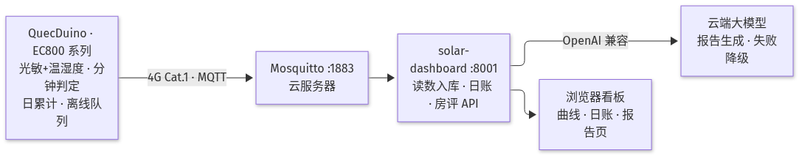

# AI房评师 —— 采光采集器与云端房评服务

What If Lab 硬件创意黑客松参赛作品。一台放在窗台的低成本光照采集器，
连续记录一个房间的真实光况，由设备端完成日照统计，云端大模型把数字
写成一份给买家看的房评报告。

一句话：**你住的房子到底亮不亮，让房子自己回答。**

## 它回答三个问题

1. 这个房间一天到底能亮几个小时？——有效日照分钟数，**灯光不计入**
2. 晒衣服、养花够不够？——三天光况自动结算成日账，给出晾晒与摆位结论
3. 住进来的体验是什么？——大模型读真实统计，生成人话版房评报告

## 仓库结构

```
device-solar/          设备固件（MicroPython / QuecPython）
  main.py              主循环：采集 → 判定 → 日账 → MQTT 上行
  config.py            引脚 / 阈值 / 上报节拍（calib 后回填两值）
  calib.py             上板标定：饱和顶值 + 模块极性
  lib/                 光照判定、温湿度、离线队列、上行通道
solar-dashboard/       云端服务（FastAPI + SQLite + 前端看板）
  app.py               读数入库、日账结算、房评报告 API、降级逻辑
  static/              看板：曲线、横向对比、关键发现、报告页、日账
mosquitto.conf         MQTT broker 配置（演示用匿名接入）
docker-compose.yml     broker + 服务的容器化启动
docs/                  架构图等
```

## 数据链路

```
光敏(分压进ADC) → 板端1s采样 → 分钟判定 → 5分钟一条 → 4G/MQTT →
云服务器入库 → 日账/曲线/报告页 ← 大模型生成房评（失败自动降级本地统计）
```



## 核心设计：灯光不算日照

开灯的晚上不是晴天。设备端用三个特征把灯光从日照里剔出去，
全部计算在板子上完成，上报的是已经算好的账：

- **基线漂移**：日落后自然光只会继续降，读数被抬离黑暗基线即异常
- **缺钟形**：自然光有日出日落的平滑坡度，灯光事件是阶跃
- **热源同步**：同一房间的灯同时抬温度，温湿度通道当第三票

阈值不靠猜：`calib.py` 上板实测饱和顶值与模块极性，回填 `config.py`
后才开始正式采集。

## 诚实条款（页面与代码同源）

- 光敏未做照度标定：系统只输出**相对光况分级**，全文不出现 lux 绝对值
- 分级由固定规则计算、可复算审计；大模型只负责措辞
- 模型不可用时自动退回本地统计评估，看板徽章如实标注来源
- MQTT 匿名接入与无鉴权看板是 48 小时演示环境的取舍，生产化需 TLS 与设备认证

## 快速开始

设备端：`calib.py` 标定 → 回填 config → `main.py` 上电自启，
开机自动向服务端注册身份，无需任何配网操作。

服务端：`docker compose up -d`（broker + 8001 看板），
模型接入在 `solar-dashboard/.env`（OpenAI 兼容接口，可选，缺失自动降级）。

## 许可

MIT。
