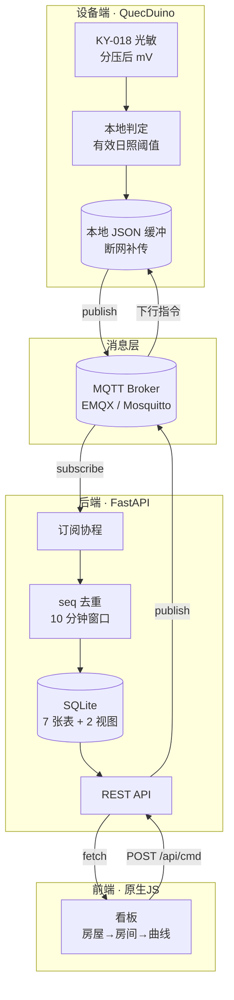

# 日光账本 · 房屋采光评估系统

一套完整的多房间采光监测系统：**设备采集 → MQTT 上报 → 数据库持久化 → Web 看板**。

不是静态 demo，数据全部来自真实数据库。

---

## 架构



---

## 数据模型

七张表，三层结构：

| 表 | 作用 | 关键点 |
| --- | --- | --- |
| `houses` | 房屋 | 空间第一层 |
| `rooms` | 房间 | `UNIQUE(house_id, name)` 防重 |
| `devices` | 设备 | `device_id` 唯一，`room_id` 外键 |
| `readings` | 时序采样 | **natural_mv 与 lamp_mv 分开存** |
| `daily_ledger` | 日账聚合 | `UNIQUE(room_id, date)`，重复上报覆盖 |
| `events` | 告警事件 | alert / recover 成对 |

两个视图：`v_room_latest`（房间最新状态宽表）、`v_device_health`（设备健康度与离线判定）。

### 为什么必须分列存 natural 和 lamp

这是整个系统的核心设计。如果只存总照度 `total`，那么：

- 无法回答"这 187 分钟里有多少是日照、多少是灯光"
- 夜晚开灯会被算进日照，评分虚高
- 无法量化"数据脏在哪"

分列之后，`lamp_inflation = naive_minutes - sun_minutes` 就是**灯光造成的虚增量**，可以直接呈现给用户。

---

## 快速开始

```bash
cd dashboard
pip install -r requirements.txt

# ① 初始化数据库（建表 + 灌演示数据，仅用于预览）
python seed_demo.py

# ② 启动后端
python -m uvicorn app:app --host 0.0.0.0 --port 8000

# ③ 浏览器打开
#    http://localhost:8000
```

`seed_demo.py` 会生成 2 套房 / 6 个房间 / 约 6000 条采样，仅用于本地预览效果。真实环境由设备上报，不需要它。

### 启动 MQTT（可选，不启也能看历史数据）

```bash
docker run -d --name mosquitto -p 1883:1883 eclipse-mosquitto
```

MQTT 连不上不影响 HTTP 服务，只是收不到实时数据。

---

## API

| 方法 | 路径 | 说明 |
| --- | --- | --- |
| GET | `/api/houses` | 房屋列表（含房间数） |
| GET | `/api/houses/{id}/rooms` | 房间 + 最新账本 + 灯光虚增 |
| GET | `/api/rooms/{id}/curve?hours=24` | 时间曲线，natural/lamp 双分量 |
| GET | `/api/rooms/{id}/ledger?days=7` | 多日账本，服务端算好评分 |
| GET | `/api/rooms/{id}/events` | 事件记录 |
| GET | `/api/devices/health` | 设备健康度与离线判定 |
| GET | `/api/overview` | 全房屋横向对比 |
| POST | `/api/cmd` | 下发指令到设备 |

---

## 设备上报格式

设备端每条消息应包含 natural 与 lamp 两个分量：

```json
{
  "type": "reading",
  "dev": "solar-ledger-01",
  "seq": 1234,
  "ts_ms": 123456,
  "natural_mv": 620,
  "lamp_mv": 0,
  "threshold_mv": 400,
  "sun_min": 187,
  "naive_sun_min": 247,
  "temp": 26.4,
  "rh": 58.2,
  "lux": 620,
  "raw": 620,
  "csq": 21
}
```

| 字段 | 必填 | 说明 |
| --- | --- | --- |
| `seq` | ✅ | 自增序号，**服务端据此去重** |
| `natural_mv` | ✅ | 自然光（mV，已扣分压） |
| `lamp_mv` | ✅ | 人工照明（mV） |
| `threshold_mv` | | 有效日照阈值，默认 400 |
| `naive_sun_min` | | 若不剔除灯光会算出的累计值 |

### 为什么去重放服务端

设备端存储紧张（NOR flash），做不了"哪条已成功送达"的精确管理；服务端空间无限。**设备只管发，服务端用 seq 兜底。**

---

## 评分规则

双档判定，单一指标都会失真：

```python
def grade(minutes, peak_mv):
    if minutes >= 300 and peak_mv >= 900: return 95, "A"
    if minutes >= 180 and peak_mv >= 650: return 82, "B+"
    if minutes >= 90  or peak_mv >= 380: return 66, "C"
    return 45, "D"
```

注意后两档用 `or`：越往下越宽松，因为采光差到这个程度再挑也没意义。而 A / B+ 用 `and`，必须时长与峰值都够。

---

## 已知限制

- **无鉴权**：公网部署必须加认证
- **MQTT 未启用 TLS**：`allow_anonymous` 仅适合内网
- **单进程单连接**：多worker 部署会导致 MQTT 重复消费，需引入队列
- **评分与 AI 解读目前在前端计算**：数据量大了应移到服务端
- **不做 lux 物理照度换算**：LDR 强非线性且对波长响应不同，无照度计标定